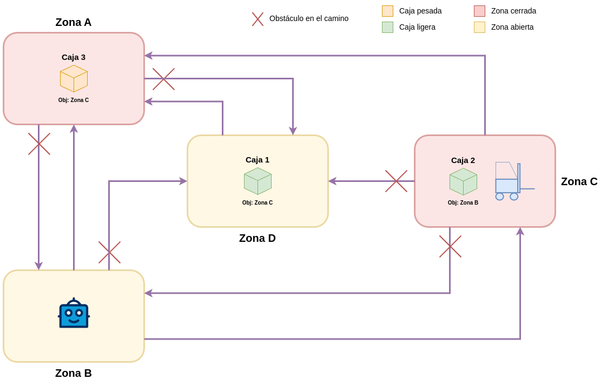

# Planificación de almacén con PDDL y STRIPS

Proyecto de planificación clásica que modela un almacén autónomo y compara un planificador PDDL con una implementación propia de búsqueda A*.

## Problema

El almacén tiene cuatro zonas, tres cajas, un robot, una carretilla, zonas cerradas y rutas bloqueadas. El objetivo es llevar cada caja a su zona de destino respetando las restricciones de movimiento y manipulación definidas en el modelo.

El repositorio incluye un dominio STRIPS tipado, una instancia del problema, un plan de referencia y un notebook que implementa una búsqueda A* propia sobre el espacio de estados. El notebook compara el resultado con la búsqueda A* de Pyperplan y su heurística `h_add`. La ejecución guardada muestra planes de 16 y 19 acciones, respectivamente.

## Estructura

- `notebooks/warehouse_planning.ipynb`: formalización del problema, ejecución con Pyperplan, implementación propia de A* y comparación.
- `pddl/`: dominio, instancia del problema y plan de referencia de Pyperplan.
- `diagrams/`: diagrama editable de Draw.io y vista previa en PNG.
- `requirements.txt`: dependencias del notebook y del planificador.

## Ejecución

Crea un entorno de Python e instala las dependencias desde la raíz del repositorio:

~~~bash
python -m venv .venv
source .venv/bin/activate
python -m pip install -r requirements.txt
jupyter lab notebooks/warehouse_planning.ipynb
~~~

En Windows PowerShell, activa el entorno con `.venv\Scripts\Activate` en lugar del comando `source`.

Para ejecutar Pyperplan directamente:

~~~bash
python -m pyperplan -s astar -H hadd pddl/domain_raa.pddl pddl/problem_raa.pddl
~~~

Ejecuta las celdas del notebook en orden. El notebook vuelve a generar los archivos PDDL a partir de la formalización antes de lanzar Pyperplan.

## Alcance

Es un ejemplo de planificación con un almacén pequeño y determinista. Ilustra la formalización de estados y acciones, además de la búsqueda. No es un sistema de control de almacenes listo para producción.

## Licencia

El código y los diagramas originales del proyecto se distribuyen bajo la [licencia MIT](LICENSE).
